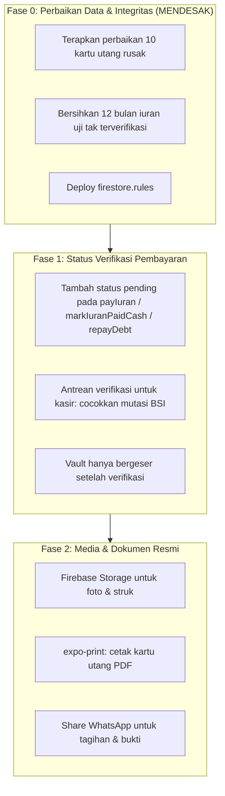

# 🔍 FEATURE GAP ANALYSIS & MASTER ROADMAP (FEATURE_PLANNING.md)

Dokumen ini memetakan seluruh fitur yang telah dibangun, membandingkan antara aplikasi **Web (React/Vite)** dan **Mobile (React Native/Expo)**, serta mengidentifikasi fitur yang sudah ada vs fitur yang belum ada (*Feature Gap Analysis*).

> **Perubahan besar sejak 10 Oktober:** seluruh admin CRUD kini berjalan di Mobile dan menulis ke Firestore. Web masih prototipe *in-memory* dan **tidak lagi** dianggap setara — lihat catatan di bagian 3.

---

## 1. MATRIKS PERBANDINGAN FITUR (FEATURE MATRIX: WEB VS MOBILE)

| Kategori Fitur | Fitur Spesifik | Status di Web | Status di Mobile (RN) | Keterangan & Catatan |
|---|---|:---:|:---:|---|
| **Autentikasi & Akun** | Login Berbasis NIK | ❌ Switcher Only | ✅ **Sudah Ada** | `LoginScreen` memvalidasi NIK & PIN lewat `loginWithNik()` yang mengembalikan `null` (sukses) atau alasan galat. |
| | Verifikasi PIN | ❌ Tidak Ada | ✅ **Sudah Ada** | PIN default = 4 digit terakhir NIK. Pesan galat PIN salah & NIK tak dikenal **dibedakan**. |
| | 1-Click Test Accounts | ⚠️ Dropdown Navbar | ✅ **Sudah Ada** | Nicholas, Sutriadi, Sapli, Hasan, Afrizal. |
| | Logout / Ganti Akun | ❌ Toggle Role | ✅ **Sudah Ada** | Tombol Logout di TopBar. |
| | Password Hash / OTP SMS | ❌ Belum Ada | ❌ Belum Ada | Masih validasi NIK & PIN 4 digit di sisi klien. |
| **Iuran Bulanan (M2)** | Tracking Multi-Bulan (Mei–Sept) | ✅ Sudah Ada | ✅ Sudah Ada | Listener `onSnapshot` per NIK; merge per pengemudi agar riwayat lain tidak hilang. |
| | Simulasi QRIS Midtrans | ✅ Sudah Ada | ✅ Sudah Ada | QR visual, countdown, tester webhook. |
| | Transfer Manual BSI | ✅ Sudah Ada | ✅ **Wajib** | Rekening asli `7352135571`. Bukti transfer **wajib** untuk transfer manual (`8b84148`). |
| | Tandai Lunas Tunai (Admin) | ✅ Sudah Ada | ✅ **Sudah Ada** | `markIuranPaidCash` — transaksional, menggeser kas kecil. |
| | Status Tertunda / Verifikasi | ❌ Belum Ada | ❌ **Belum Ada** | **Celah desain utama.** Lihat bagian 3. |
| | Midtrans API Production | ⚠️ Simulasi | ⚠️ Simulasi | Mock webhook client-side. |
| **Dana Talang (M3)** | Kartu Piutang Anggota | ✅ Sudah Ada | ✅ Sudah Ada | Sisa utang, rincian laka, progress bar. |
| | Tambah / Hapus Kartu (Admin) | ✅ Sudah Ada | ✅ **Sudah Ada** | `addDebt` / `deleteDebt`, transaksional bersama vault. |
| | Setoran Cicilan | ✅ Sudah Ada | ✅ **Sudah Ada** | `repayDebt` atomik: kartu utang + vault dalam satu transaksi. |
| | Cetak Kartu Utang ke PDF | ⚠️ Browser Print | ❌ Belum Ada | Perlu `expo-print`. |
| **Lapor Perbaikan (M4)** | Input Nomor Body & Lokasi | ✅ Sudah Ada | ✅ Sudah Ada | Body 237–285, titik lokasi insiden. |
| | Checklist Kerusakan | ✅ Sudah Ada | ✅ Sudah Ada | Baret, gompal, spion pecah. |
| | Toggle Suket & Mekanik | ✅ Sudah Ada | ✅ Sudah Ada | Menentukan kas keluar untuk suket/konsumsi. |
| | **Foto Kerusakan Nyata** | ⚠️ Mock File Input | ✅ **Sudah Ada** | Thumbnail base64 400px, maks 3 foto per dokumen (`8b84148`). |
| | Kanban Status Laporan | ✅ Sudah Ada | ✅ **Sudah Ada** | `updateIncidentStatus` di tab A5. |
| **Kas Terbuka (M5)** | Transparansi Arus Kas | ✅ Sudah Ada | ✅ Sudah Ada | 15 pengeluaran September 2026. |
| | Filter Kategori & Pencarian | ✅ Sudah Ada | ✅ **Diperbaiki** | Chip diambil dari data (`7a7cec5`), bukan daftar mati — sebelumnya cocok 0 dari 15. |
| | Tambah / Hapus Pengeluaran | ✅ Sudah Ada | ✅ **Sudah Ada** | `addExpense` / `deleteExpense`. |
| **Admin View** | KPI Eksekutif (A1) | ✅ Sudah Ada | ✅ Sudah Ada | Kas kecil, saldo BSI, total pengeluaran. |
| | Matriks Iuran (A2) | ✅ Sudah Ada | ✅ **Sudah Ada** | `AdminIuran.js`. |
| | Buku Kas Pengeluaran (A3) | ✅ Sudah Ada | ✅ **Sudah Ada** | `AdminPengeluaran.js`. |
| | Buku Piutang (A4) | ✅ Sudah Ada | ✅ **Sudah Ada** | `AdminPiutang.js`, termasuk modal cicilan sebagian. |
| | Logbook Armada (A5) | ✅ Sudah Ada | ✅ **Sudah Ada** | `AdminLogbook.js`, 3 kolom status. |
| | **Manajemen Anggota (A6)** | ❌ Tidak Ada | ✅ **Baru** | Cari, filter, tambah, edit, nonaktifkan. `AdminAnggota.js` (`a48d52c`). |
| | Penghapusan Anggota Permanen | ❌ Tidak Ada | ❌ **Sengaja Tidak Ada** | Anggota hanya dinonaktifkan — riwayat utang & iuran adalah catatan keuangan. |
| **Backend & Sync** | Cloud Firestore Live | ❌ In-Memory | ✅ **Sudah Ada** | Real-time via `onSnapshot`. |
| | 7 Mutasi Transaksional | ❌ In-Memory | ✅ **Sudah Ada** | Lihat `AppContext.js` (`5718a1b`). |
| | Security Rules | ❌ Tidak Ada | ✅ **Ditulis, belum deploy** | Integritas data, bukan otorisasi (tanpa Firebase Auth). |
| | Ekspor CSV / Excel | ✅ Sudah Ada | ✅ **Sudah Ada** | `utils/csvExport.js` untuk laporan DAMRI (`8b84148`). |
| | Pemeriksaan Impor Statis | ❌ Tidak Ada | ✅ **Sudah Ada** | `npm run check:imports`, ~90ms, 23 file. |

---

## 2. REKOMENDASI TAHAPAN FITUR BARU (ROADMAP IMPLEMENTATION)

### Prioritas 1: Perbaikan Data Langsung (Fase 0)
Sepuluh kartu utang menunjuk ke NIK tanpa dokumen anggota sehingga tidak terlihat oleh pramudi pemiliknya, dan 12 bulan iuran senilai Rp1.200.000 tercatat lunas padahal belum diverifikasi.

- Jalankan `node src/data/repairDebtCards.mjs --dry-run` untuk memeriksa rencana, lalu tanpa flag untuk menulis.
- Kembalikan saldo vault ke angka semula (BSI +Rp400.000, kas kecil +Rp150.000 adalah sisa uji coba).
- Tentukan nasib `DEBT-657796` dan `DEBT-918342` yang hanya ada dalam pengujian.

### Prioritas 2: Status Verifikasi Pembayaran (Fase 1)
Ini akar masalah dari seluruh kontaminasi di atas. Saat ini `payIuran`, `markIuranPaidCash`, dan `repayDebt` menulis `lunas` dan menggeser vault **seketika**. Satu ketukan uji coba langsung menjadi catatan keuangan.

Diperlukan: pembayaran masuk sebagai **pending**, kasir mencocokkan dengan mutasi BSI/rekening, baru saldo bergeser.

### Prioritas 3: Dokumen Resmi & Media (Fase 2)
- `expo-print` untuk kartu utang bertanda tangan, memakai kop `KARTU UTANG PIUTANG DAN DANA TALANG PAGUYUBAN EV 50`.
- Firebase Storage untuk foto kerusakan beresolusi penuh (thumbnail base64 di dokumen hanya solusi sementara karena Storage belum diaktifkan).
- Share WhatsApp untuk tagihan dan bukti.

---

## 3. POSISI WEB vs MOBILE

Web di root adalah **prototipe awal** dengan CRUD *in-memory* — perubahannya hilang saat muat ulang. Semua kerja produksi terjadi di `/mobile`.

Menjaga keduanya setara (prinsip dual-platform di `ONBOARDING.md`) berarti tiap fitur baru butuh padanan di dua sisi. Itu terbukti mahal: perbaikan filter pengeluaran, manajemen anggota, dan seluruh admin CRUD hanya dikerjakan di Mobile.

**Keputusan yang belum dibuat:** apakah Web ditingkatkan ke Firestore, dipertahankan sebagai prototipe demo, atau dihentikan. Pertanyaan ini layak dijawab sebelum Fase 2 agar tenaga tidak terbelah.
