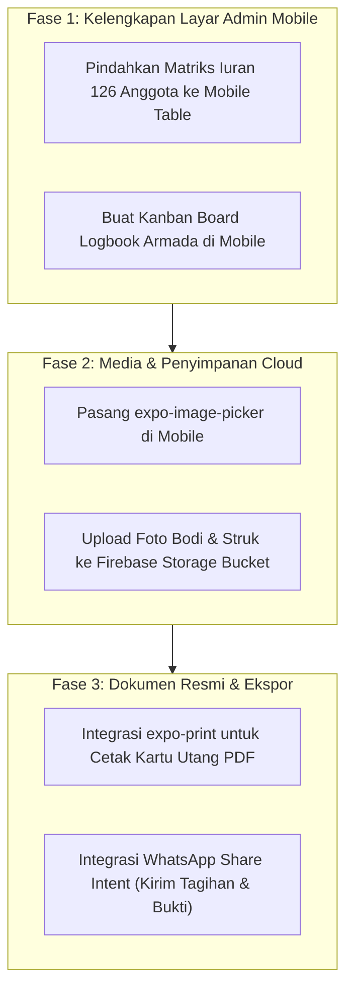

# 🔍 FEATURE GAP ANALYSIS & MASTER ROADMAP (FEATURE_PLANNING.md)

Dokumen ini memetakan seluruh fitur yang telah dibangun, membandingkan antara aplikasi **Web (React/Vite)** dan **Mobile (React Native/Expo)**, serta mengidentifikasi fitur yang sudah ada vs fitur yang belum ada (*Feature Gap Analysis*).

---

## 1. MATRIKS PERBANDINGAN FITUR (FEATURE MATRIX: WEB VS MOBILE)

| Kategori Fitur | Fitur Spesifik | Status di Web | Status di Mobile (RN) | Keterangan & Catatan |
|---|---|---|---|---|
| **Autentikasi & Akun** | Login Berbasis NIK | ❌ (Switcher Only) | ✅ **Sudah Ada** | Mobile memiliki `LoginScreen` dengan validasi NIK & PIN. |
| | 1-Click Test Accounts | ⚠️ Dropdown Navbar | ✅ **Sudah Ada** | Nicholas (17002197), Sutriadi, Sapli, Hasan, Afrizal. |
| | Logout / Ganti Akun | ❌ (Toggle Role) | ✅ **Sudah Ada** | Tombol Logout merah di TopBar mobile. |
| | Password Hash / OTP SMS | ❌ Belum Ada | ❌ Belum Ada | Masih validasi NIK & 4 digit PIN di sisi client. |
| **Iuran Bulanan (M2)** | Tracking Multi-Bulan (Mei–Sept) | ✅ Sudah Ada | ✅ Sudah Ada | Tampilan status lunas, tunggakan, dan nominal. |
| | Simulasi QRIS Midtrans | ✅ Sudah Ada | ✅ Sudah Ada | QR code SVG visual, countdown, tester webhook. |
| | Transfer Manual BSI | ✅ Sudah Ada | ✅ Sudah Ada | Info rek 720510945 a.n Paguyuban EV 50 Cawang. |
| | Midtrans API Production | ⚠️ Simulasi | ⚠️ Simulasi | Menggunakan mock webhook client-side. |
| **Dana Talang (M3)** | Kartu Piutang Anggota | ✅ Sudah Ada | ✅ Sudah Ada | Menampilkan sisa utang & rincian laka. |
| | Riwayat Mutasi Debet/Kredit | ✅ Sudah Ada | ✅ Sudah Ada | Riwayat pencairan dan riwayat cicilan. |
| | Form Setoran Cicilan Driver | ✅ Sudah Ada | ✅ Sudah Ada | Mengurangi sisa saldo dan menambah kas. |
| | Cetak Kartu Utang ke PDF | ⚠️ Browser Print | ❌ Belum Ada | Memerlukan integrasi `expo-print` di Mobile. |
| **Lapor Perbaikan (M4)**| Input Nomor Body Bus (237–285)| ✅ Sudah Ada | ✅ Sudah Ada | Dropdown body dan titik lokasi insiden. |
| | Checkbox Bagian Kerusakan | ✅ Sudah Ada | ✅ Sudah Ada | Baret bemper, gompal, spion pecah, dll. |
| | Toggle Suket Laka Kepolisian | ✅ Sudah Ada | ✅ Sudah Ada | Indikator butuh biaya suket kas paguyuban. |
| | Toggle Pendampingan Mekanik | ✅ Sudah Ada | ✅ Sudah Ada | Kebutuhan Mekanik KLI atau Mekanik Uday. |
| | Upload Foto Kerusakan Nyata | ⚠️ Mock File Input| ⚠️ Mock File Input| Belum direct upload ke Firebase Storage. |
| **Kas Terbuka (M5)** | Transparansi Arus Kas Keluar | ✅ Sudah Ada | ✅ Sudah Ada | Membaca 15 pengeluaran September 2026. |
| | Filter Kategori & Pencarian | ✅ Sudah Ada | ✅ Sudah Ada | Bansos, talangan, sparepart, cat, konsumsi. |
| | Modal Bukti Nota Kuitansi | ✅ Sudah Ada | ⚠️ Belum Lengkap | Web memiliki visual kuitansi digital modal. |
| **Admin View (A1–A5)** | Executive Financial KPI (A1) | ✅ Sudah Ada | ✅ Sudah Ada | Kartu kas kecil, saldo BSI, total pengeluaran. |
| | Matriks Iuran 126 Anggota (A2) | ✅ Sudah Ada | ⚠️ List Ringkas | Web memiliki spreadsheet table Mei–September. |
| | Buku Kas Pengeluaran (A3) | ✅ Sudah Ada | ⚠️ Tab Kas Terbuka | Web memiliki form tambah pengeluaran baru. |
| | Buku Piutang & Setoran Admin (A4)| ✅ Sudah Ada | ⚠️ Drawer Tertentu | Web memiliki drawer kartu utang komplit. |
| | Kanban Logbook Armada (A5) | ✅ Sudah Ada | ❌ Belum Ada | Web memiliki 3 kolom Kanban: Masuk, Proses, Selesai. |
| **Backend & Sync** | Cloud Firestore Live Database | ❌ State Memory | ✅ **Sudah Ada** | Mobile sync real-time via `onSnapshot`. |
| | Offline Storage Cache | ❌ Belum Ada | ✅ Memory + Local | Data tersimpan lokal jika offline. |
| | Export CSV / Excel Data | ✅ Sudah Ada | ❌ Belum Ada | Web bisa download file CSV rekap iuran. |

---

## 2. REKOMENDASI TAHAPAN FITUR BARU (ROADMAP IMPLEMENTATION)

### Prioritas 1: Melengkapi Fitur Admin di Mobile App
- **Layar Kanban Logbook Armada Bodi:** Memindahkan tampilan 3 kolom status (*Laporan Baru Masuk*, *Sedang Dikerjakan Mekanik*, *Selesai*) ke dalam tab khusus Admin di Mobile app.
- **Tabel Matriks Iuran 126 Pramudi:** Memberikan tabel scrollable horizontal bagi admin untuk mencentang status lunas iuran per anggota secara cepat.

### Prioritas 2: Firebase Storage untuk Foto Kerusakan Fisik
- Menggantikan nama file tiruan dengan file upload nyata menggunakan `expo-image-picker`.
- Mengunggah foto kamera pengemudi langsung ke `paguyuban-ev50.firebasestorage.app` dan menyimpan URL download-nya di Firestore.

### Prioritas 3: Pembuatan Dokumen PDF Sah (Kartu Utang Driver)
- Memanfaatkan library `expo-print` untuk menghasilkan file PDF bertanda tangan digital dengan template resmi dari sheet `DATA HUTANG ANGGOTA.xlsx` (seperti kasus Nicholas NIK 17002197 Rp910.000).
- Menyediakan tombol *Share to WhatsApp* untuk mengirimkan file PDF langsung ke pengemudi.
